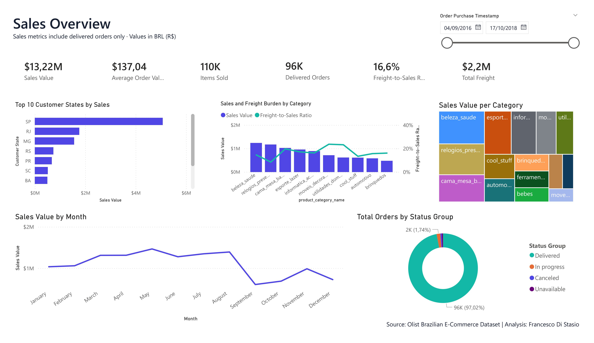

# Francesco Di Stasio - Data Analyst Portfolio

## About me

Hi, I’m Francesco, a Data Analyst and Lecturer based in Germany, with a PhD in Electrical, Electronics and Communications Engineering.
My background spans academic research, telecommunications, and teaching, with a focus on statistical modeling and data analysis.
I use Python, SQL, MATLAB, and Power BI to explore complex datasets and communicate meaningful insights.
This portfolio showcases my projects in data analytics, machine learning, and visualization.

Read here my [CV](./CV.pdf)

## TV Show Cancellation: Exploring First-Season Risk Factors

The goal is to investigate which first-season characteristics are associated with TV show cancellation.

1. [Prepare the dataset](TV_Shows_project_getDataset.ipynb)The first notebook integrates and cleans the sources, engineering features such as episode rating trends, voting activity, and release strategy. 
2. [Model](TV_shows_project.ipynb) The second performs exploratory analysis and builds a logistic regression classifiern.

**Tools:** Python, pandas, NumPy, Requests, Matplotlib, Seaborn, scikit-learn, Jupyter Notebook.

**Results:** Built a dataset of 2,143 TV shows before final preprocessing. Higher first-season ratings showed a weak negative correlation with cancellation. The baseline model achieved 80% test accuracy but only 1% recall for canceled shows, highlighting poor minority-class detection and the need for further model refinement.

## Brazilian E-Commerce: Delivery Performance & Customer Satisfaction

An analysis of the public Olist dataset using Python to explore delivery delays, customer reviews, and differences across regions, product categories, and sellers.

**Project Notebooks**
1. [Data Preparation](./Brazilian_E-Commerce_dataPrep.ipynb) — Data cleaning, type conversion, and quality checks.
2. [Data Integration](./Brazilian_E-Commerce_dataIntegration.ipynb) — Dataset merging and order-level aggregation.
3. [Exploratory Data Analysis](./Brazilian_E-Commerce_EDA.ipynb) — Delivery metrics, visualizations, and business insights.

**Results**: Late deliveries were associated with substantially more low ratings: 62.37% versus 9.27% for on-time orders.

**Tools:** Python, pandas, NumPy, Matplotlib, Seaborn.

### Interactive Dashboard
[Explore the Tableau dashboard](https://public.tableau.com/app/profile/francesco.di.stasio/viz/Brazialian_ECommerce/Dashboard1)

### PowerBI Dashboard

- [Read the report (PDF)](./Olist_Ecommerc_Report.pdf)

## Retail Sales & Profitability Dashboard

A Power BI reporting project exploring sales, profitability,
product performance, customer segments, and regional trends.

[View the report (PDF)](./report2.pdf)

**Data source:** The original dataset source and version
could not be verified. This report is presented as a dashboard
design and analysis exercise.

## 3GPP TR 38.901 Channel Model — MATLAB Implementation

A MATLAB implementation of selected channel-modeling procedures
described in 3GPP TR 38.901, developed collaboratively for wireless
propagation research and simulation.

**Tools:** MATLAB  
**Topics:** Wireless communications, channel modeling, propagation simulation.

**Authors:** Francesco Di Stasio, Daniel Riviello, Riccardo Tuninato.

[View the project](./3gpp-channel-model-tr-38901-main.zip)
